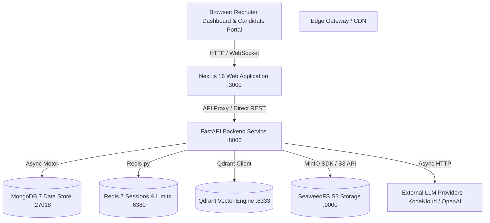

# Architecture Specification: EvalixAI

## 1. System Context Diagram

---

## 2. Component Subsystems
1. **Frontend Presentation Layer (`src/`):**
   - **`src/app/(dashboard)/`**: Protected recruiter management cockpit (pipeline, candidates, jobs, analytics).
   - **`src/app/(portal)/`**: Public candidate interface for job applications, proctored testing, and interview room.
   - **`src/components/ui/`**: Radix UI + Tailwind CSS atomic design components.
   - **`src/lib/api-client.ts`**: Unified Axios/Fetch API client featuring automatic credentials handling and token refresh.
2. **Backend Application Layer (`backend/app/`):**
   - **`api/v1/`**: Routers for `auth`, `jobs`, `candidates`, `assessments`, `interviews`, `analytics`, `uploads`.
   - **`core/`**: Security (`bcrypt`, `jwt`), database managers, settings, and CORS policies.
   - **`services/`**: Domain services:
     - `evalix_screening`: Resume parsing, heuristic evaluation, Qdrant vector operations.
     - `evalix_interview`: Question generator, speech evaluation, scoring synthesis.
     - `evalix_proctoring`: Anomaly detection, telemetry aggregation, violation tracking.
   - **`models/` & `schemas/`**: Pydantic v2 schemas and validation models.
3. **Data & Storage Infrastructure:**
   - **MongoDB collections:** `users`, `jobs`, `candidates`, `assessments`, `interviews`, `audit_logs`.
   - **Qdrant collections:** `candidate_profiles` with 384/1536-dimensional dense vectors.
   - **S3 Buckets:** `resumes`, `interview-recordings`, `audit-exports`.
