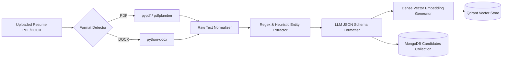

# Scraping & Ingestion Engine Specification: EvalixAI

## 1. Overview
The scraping and extraction engine is responsible for parsing candidate resumes, external portfolios (e.g. GitHub, LinkedIn profiles where consented), and job market benchmarks.

---

## 2. Resume Parsing Architecture

---

## 3. Parsing Stages & Fault Tolerance
1. **Raw Text Extraction:**
   - Multi-column layout flattening.
   - Elimination of non-printable characters and control codes.
2. **Anomaly & Heuristic Screening:**
   - Detects hidden white-font keywords (prompt injection / ATS gaming).
   - Detects suspicious keyword blocks or duplicated credentials.
3. **Structured Entity Extraction:**
   - Personal info: Name, Email, Phone, Social Profiles.
   - Work history: Titles, Companies, Start/End dates, Achievements.
   - Skills: Disambiguation between programming languages, frameworks, and tools.
4. **Resilience & Fallback:**
   - If external LLM service times out ($> 30\text{ s}$), system falls back automatically to local dictionary-based keyword matching and heuristic ranking to avoid blocking the candidate experience.
